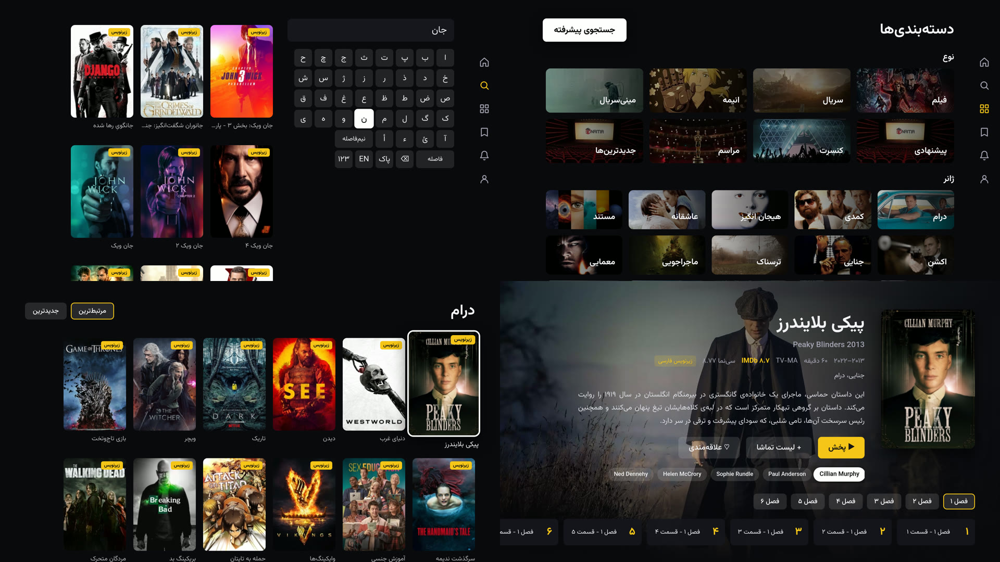

# 30nama TV

[](https://github.com/sponsors/aliir74)
[](https://www.buymeacoffee.com/aliir74)

An unofficial [30nama](https://30nama.com) app for Samsung TVs (Tizen). Browse, search and stream
with Persian subtitles, all from the TV remote.

30nama has an official Android TV app but nothing for Samsung's Tizen TVs, so on a Samsung the
choice was a phone cast or a laptop over HDMI. This app talks to the same API as the official TV
client, so it shows the same catalogue and keeps your continue-watching in sync with your other
devices. The interface is Persian and right-to-left.



> **You need your own 30nama account with an active plan, and a Samsung TV in Developer Mode.**
> Samsung only installs apps from its store, so this one is installed the developer way: with a
> Samsung certificate made for your own TV. It takes about 20 minutes once. See [Install](#install).

## What it does

| Area | |
|---|---|
| Sign in | QR code: scan it with a phone that is logged in to 30nama and approve |
| Home | Featured title, continue watching, suggested, movies, series, anime |
| Search | On-screen Persian, English and digit keyboard; results update as you type |
| Browse | Categories and genres, advanced filters (type, genre, IMDb score, decade, country), newest or most relevant |
| Title page | Seasons and episodes, cast and director (each opens their other titles), watchlist and favourites |
| My list | Watchlist, favourites, continue watching (with remove) |
| Player | HLS up to 1080p, Persian or English subtitles in three sizes, stereo or 5.1, skip intro, a next-episode countdown at the credits, resume where you left off on any device |

Only titles that stream are listed. Downloads, payments, ratings and comments are not in the app,
because the API the official TV client uses has no way to do them.

## Requirements

**1. A Samsung TV on Tizen 6.5 or later**, which is roughly the 2022 models onward. Tested on a 2025
model running Tizen 9.0.

**2. Tizen Studio CLI** with the Samsung certificate extension and the TV extensions. The
[CLI installer](https://developer.tizen.org/development/tizen-studio/download) is enough; the IDE
is not needed. After installing:

```bash
~/tizen-studio/package-manager/package-manager-cli.bin install \
  cert-add-on Certificate-Manager TV-SAMSUNG-Public-WebAppDevelopment --accept-license
```

**3. A Samsung account**, to create the certificate. Any account works; it does not need to be the
one on the TV.

**4. The client key.** Requests carry a `c-api-key` header, the same one the official 30nama TV web
client (`tv.30app.store`) sends. It is not included in this repo. You can read it from that client's
network requests in your browser's developer tools.

**5. Node 20 or later**, only if you build from source.

## Install

**1. Turn on Developer Mode on the TV.** Open Apps, press `1 2 3 4 5` on the remote, switch
Developer Mode on, enter your computer's IP address, then restart the TV.

**2. Connect to it.**

```bash
~/tizen-studio/tools/sdb connect <tv-ip>
~/tizen-studio/tools/sdb -s <tv-ip>:26101 shell 0 getduid    # note this; the certificate needs it
```

**3. Create a Samsung certificate profile** named `30nama`. Open
`~/tizen-studio/tools/certificate-manager/Certificate-manager.app`, add a profile, choose
**Samsung** then **TV**, create a new author certificate (sign in with your Samsung account when
the browser opens), then a new distributor certificate with privilege **Public**. With the TV
connected, its DUID is already in the list; if not, add the one from step 2.

**4a. From a release** (no Node needed). Download `30nama-tv-<version>.zip` from
[Releases](https://github.com/aliir74/30nama-tv/releases), unzip it, and put the client key into
`config.json` inside the folder:

```json
{ "apiKey": "<the c-api-key value>" }
```

Then sign and install:

```bash
cd 30nama-tv
~/tizen-studio/tools/ide/bin/tizen package -t wgt -s 30nama -- .
mv ./*.wgt 30nama-tv.wgt    # the installer rejects the Persian file name it is given
~/tizen-studio/tools/ide/bin/tizen install -n 30nama-tv.wgt -s <tv-ip>:26101
```

**4b. From source.**

```bash
git clone https://github.com/aliir74/30nama-tv && cd 30nama-tv
npm install
echo 'VITE_API_KEY=<the c-api-key value>' > .env.local    # git-ignored
scripts/tv.sh <tv-ip>       # builds, signs with the "30nama" profile, installs, launches
```

The app then sits in the TV's app list as **سی‌نما TV**. Open it, scan the QR code with your
phone, approve, and you are in.

## Using it

| Key | Browsing | Player, controls hidden | Player, controls shown |
|---|---|---|---|
| Arrows | Move | Left/Right seek 10 s; hold to speed up (30 s, then 60 s); Up/Down show controls | Move; on the seek bar, Left/Right seek |
| OK | Open | Pause and show controls | On the seek bar: play or pause |
| Back | Back; on home, exit | Leave the player | Close a panel, then hide the controls |
| ▶❚❚ ⏪ ⏩ | | Play/pause, seek 30 s | Same |
| ⏮ ⏭ | | Previous (restarts the episode first) / next episode | Same |
| Red | Debug log | Debug log | Debug log |

The side menu is on the right edge: press Right from the rightmost item on any main screen.
Settings (default subtitle language and size, stereo or 5.1, starting quality) and sign-out are
under **حساب و تنظیمات**.

## Limits

**Installed the developer way, so it is tied to your TV.** The certificate carries your TV's DUID.
Another TV needs a distributor certificate that includes its DUID too, and a re-sign.

**The client key can change.** If 30nama rotates it, every request fails until you put the new value
in `config.json` (or `.env.local`) and reinstall.

**Cloudflare sits in front of the API.** The TV runtime passes today. If 30nama tightens it, the
login screen shows «سرور سی‌نما درخواست را مسدود کرد» and nothing loads; there is no workaround in
the app.

**No downloads, ratings, comments, collections or box office.** The v2 API the official TV client
uses has no actions for them. `TASKS.md` lists every action it does have.

**Removing a title from continue watching can take a few minutes to show** after you have just
watched it. The server caches the list.

## Troubleshooting

**`install failed` or a certificate error during install.** The distributor certificate does not
include this TV's DUID. Check it with `sdb shell 0 getduid` and recreate the distributor
certificate with it.

**`There is no connected target`.** The `sdb` connection drops now and then. Run
`sdb connect <tv-ip>` again. If it refuses, the IP in the TV's Developer Mode settings must be the
computer's current address.

**The login screen shows an error instead of a QR code.** Press Red to open the debug log; the
failing line names the step and the server's answer. «سرور سی‌نما درخواست را مسدود کرد» means
Cloudflare blocked the request. Any other refusal on the very first call usually means the client
key is missing or out of date.

**Playback starts blurry.** It should open at 1080p within a couple of seconds. On a slow network,
pick a fixed quality under **حساب و تنظیمات** → **کیفیت تصویر**.

## How it works

A Vite, React and TypeScript web app, built for Chromium 85 (the browser in Tizen 6.5) and loaded
from `file://` inside the `.wgt` package.

- **Navigation:** [norigin spatial navigation](https://github.com/NoriginMedia/Norigin-Spatial-Navigation)
  maps the remote's arrows onto what is on screen. Each screen is a focus boundary, and screens
  under the current one stay mounted, so Back returns you to the same item.
- **API:** the v2 actions the official TV client uses, as form-encoded POSTs with its headers.
  `src/api/endpoints.ts` is the whole surface.
- **Playback:** [hls.js](https://github.com/video-dev/hls.js) over Media Source Extensions, so the
  app picks the quality and the stereo or 5.1 audio track. Subtitles are SRT or VTT, parsed in the
  app and drawn over the video. Progress goes back to 30nama every 30 seconds, so continue watching
  matches your other devices.
- **Smoothness on TV hardware:** no CSS transitions, and every scrolling area is a real scroller,
  so Chromium moves it on the GPU. Animated focus effects were costing 100 to 250 ms per frame on a
  2025 TV.

`TASKS.md` records the API behaviour the app depends on, with the quirks found along the way: for
example, `streamonly` must be the string `"true"`, and people pages only match exactly by IMDb ID.

## Development

```bash
npm run dev      # http://localhost:5173, 1920x1080
```

In a desktop browser the arrows, Enter and Backspace (or Escape for Back) drive it like a remote,
and `r` opens the debug log. On the TV, `scripts/tv.sh` launches the app with the web inspector on;
the last line of its output names the port, and `http://<tv-ip>:<port>` opens Chrome DevTools for it.

## Disclaimer

Not affiliated with 30nama. It uses your own account and plan, and shows only what the official
apps show you.

## Support This Project

If you find this project useful, consider supporting its development:

- Star this repo
- Report bugs and submit PRs
- [Sponsor on GitHub](https://github.com/sponsors/aliir74) or [Buy me a coffee](https://www.buymeacoffee.com/aliir74)
